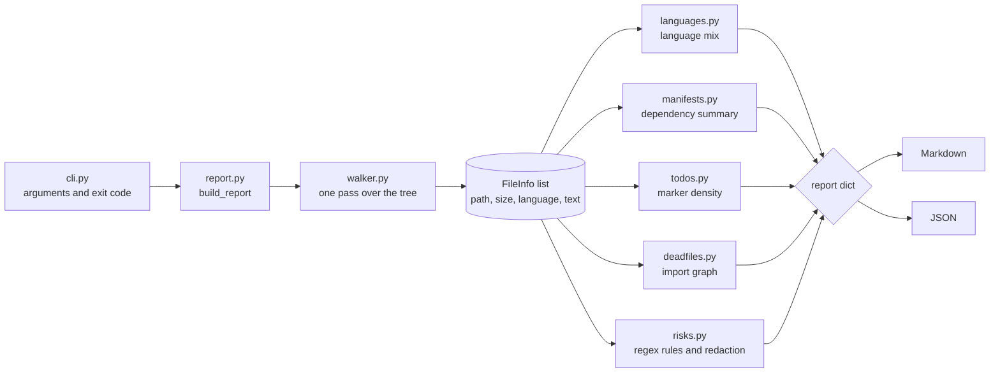

# codebase-scanner

You have just inherited a repository you did not write. Before you change anything you need to know three things: what is in it, what looks abandoned, and what looks dangerous.

codebase-scanner answers those in one command. Point it at a folder and it writes a short report (Markdown for people, JSON for tools) that lists:

- how the code is laid out, which languages it uses and where the big files are
- which dependencies are declared and which are not pinned to an exact version
- where the `TODO` and `FIXME` notes pile up
- Python and JavaScript/TypeScript files that nothing else imports (likely dead code)
- risky lines: credentials typed into source, `eval`, `shell=True`, disabled TLS checks and similar

It is for developers and agencies taking over a codebase, and for anyone who wants a quick first look before quoting or planning work. It is a first pass that tells you where to look, not a security audit.

It is a small Python command line tool (3.11 or newer, standard library only). It reads files and nothing else: no network calls, no API keys, no services.

## What you will see

Real output from scanning the small made-up repository bundled with the tests (`tests/fixtures/sample_repo`), copied from [`demo/output.txt`](demo/output.txt). The credentials in that fixture are fake and are redacted in the report anyway.

```text
$ codebase-scanner tests/fixtures/sample_repo

# Codebase scan: sample_repo

- Files: 15 in 5 directories (max depth 1)
- Lines: 231, bytes: 8562, binary files: 0
- TODO markers: 6 (68.2 per 1000 lines of code)
- Likely dead files: 2
- Risk findings: 3 high, 2 medium, 2 low

## Likely dead files

| Path | Language | Lines | Reason |
| --- | --- | --- | --- |
| app/legacy_report.py | Python | 12 | never imported by another file in the repository |
| web/old_widget.js | JavaScript | 5 | never imported by another file in the repository |

## Risky patterns

| Severity | Rule | Location | Excerpt |
| --- | --- | --- | --- |
| high | hardcoded-credential | app/config.py:6 | `DB_PASSWORD = "fixt********"` |
| high | aws-access-key-id | app/config.py:7 | `AWS_ACCESS_KEY_ID = "AKIA********"` |
| medium | python-eval-exec | app/legacy_report.py:8 | `return eval(formula)` |
```

The full report also has the structure, language mix, largest files, dependency and TODO sections. CI fails if `python demo/run_demo.py` stops reproducing `demo/output.txt` exactly.

## Run it

```bash
python -m venv .venv
source .venv/bin/activate        # Windows: .venv\Scripts\activate
pip install -e .
codebase-scanner path/to/repo
codebase-scanner path/to/repo --out scan-output --format json
```

No install is needed either: `python -m codebase_scanner path/to/repo` works from a checkout.

| Flag | Effect |
| --- | --- |
| `--format markdown\|json` | What to print to stdout (default `markdown`). |
| `--out DIR` | Also write `report.md` and `report.json` into `DIR`. |
| `--top N` | How many largest files to list (default 10). |
| `--max-file-bytes N` | Files above this size are counted but not read (default 1000000). |
| `--fail-on high\|medium\|low` | Exit with status 2 when a finding at or above that severity exists, for use in CI. |
| `--quiet` | Print nothing to stdout. |

Add `scanner:ignore` to a line to suppress risk findings on it. `.env.example` lists the two optional environment variables that change defaults; there is no other configuration. Output is always UTF-8.

## What each section reports

- **Structure**: file and directory counts, depth, and a breakdown per top level entry.
- **Language mix**: files, lines and bytes per language, with each language's share of lines.
- **Largest files**: the top N files by size.
- **Dependency manifests**: `requirements*.txt`, `pyproject.toml`, `package.json` and `go.mod`, with each dependency's version spec, scope and whether it is pinned to one exact version.
- **TODO density**: `TODO`, `FIXME`, `HACK` and `XXX` markers per file and per 1000 lines of code.
- **Likely dead files**: Python and JavaScript/TypeScript files that no other file in the repository imports.
- **Risky patterns**: hard coded credentials, AWS key ids, GitHub tokens, private key blocks, `eval`, `shell=True`, unsafe deserialization, disabled TLS verification, `innerHTML` assignment and debug flags. Any value a secret rule matches is cut to its first four characters plus `********` in every excerpt, in both output formats.

## Architecture



The walker reads the tree once and every analyzer works from the same in-memory file list, so each analyzer is a small independent module with its own tests. Both renderers take the same report dict, which keeps the Markdown and JSON outputs in agreement.

## Tests

```bash
pip install -e ".[dev]"
python -m pytest -q
```

27 tests. The suite runs the scanner end to end on the bundled synthetic repository, which has planted TODOs, two never imported files and obviously fake credentials, and checks every report section against known answers. Unit tests cover the parsers, import resolution, the risk rules and redaction on small temporary repositories. CI (`.github/workflows/ci.yml`) runs the same tests on Python 3.11 and 3.12 on Linux and checks that the demo still reproduces its captured output.

## Demo

```bash
python demo/run_demo.py
```

Scans the fixture repository offline and prints the Markdown report, the risks section of the JSON report and the `--fail-on` exit code. The captured output is in [`demo/output.txt`](demo/output.txt).

## Where this pattern runs

This is a clean, standalone version of a scan the author runs on private automation repositories before larger changes, to catch leftover files, drifting dependencies and credentials that slipped into source. Nothing from those repositories is included here; all sample data is synthetic.

## Limitations

- **What it has been run on.** The tests and demo use one 15 file synthetic repository and small temporary repositories built inside the tests. There are no accuracy figures from real projects and no speed or memory benchmarks. Every readable file is loaded into memory at once, so very large repositories have not been proven to work.
- **Nothing is mocked because nothing is integrated.** The tool calls no external service. It does not look up known vulnerabilities, check whether a credential is live, or read git history, so a secret that was committed and later deleted is not found.
- **Dead file detection is static and name based.** It only covers Python and JavaScript/TypeScript. It cannot see dynamic imports (`importlib`, computed `require` paths), plugin entry points, framework auto discovery or files referenced only from configuration, so it reports "likely" dead files, not certain ones. When an import could match several files, all of them count as used. A Python file that fails to parse (Python 2 code, a syntax error) contributes no imports, so the files it imports can be listed as dead by mistake.
- **JavaScript imports are found with a regular expression, not a parser.** Path aliases (for example `@/components`) and TypeScript imports written with a `.js` suffix that point at a `.ts` file are not resolved.
- **Risk rules are line based regular expressions.** They flag fake values in test fixtures and matches inside comments or strings. They miss secrets that are split across lines, encoded, unquoted (for example `KEY=value` lines in a `.env` or YAML file), or stored under a name the rules do not recognise. Markdown, HTML, CSS and CSV files are not scanned for risks. Use a dedicated secret scanner and a security review for anything that matters.
- **Redaction keeps the first four characters** of a matched secret, and only covers values the secret rules match. Treat a report on a private repository as sensitive.
- **Line counts are physical lines,** including blanks and comments, and "lines of code" means all lines in source files. The language is inferred from the file extension only.
- **`.gitignore` is not read.** A fixed list of vendored and cache directories (`.git`, `node_modules`, virtual environments, build output) is skipped instead. Symbolic links are skipped.
- **Manifest parsing covers common cases only:** no lock files, no Poetry or Cargo sections, no transitive dependencies. "Pinned" means the manifest names one exact version, not that the install is reproducible.
- **Files over the size cap** are counted but not analysed, files containing NUL bytes (UTF-16 text, for example) are treated as binary, and other bytes that are not valid UTF-8 are replaced before analysis.

License: MIT, see the LICENSE file.
