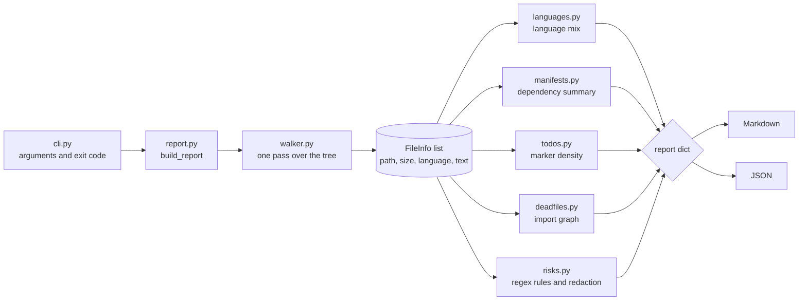

# codebase-scanner

Picking up an unfamiliar repository means answering the same questions by hand every time: what is in here, what is abandoned, and what is dangerous.
codebase-scanner answers them in one pass and writes the result as Markdown for people and JSON for tools.

## What it does

Point it at a directory and it reports:

- **Structure**: file and directory counts, depth, and a per top level entry breakdown.
- **Language mix**: files, lines and bytes per language, with each language's share of lines.
- **Largest files**: the top N files by size.
- **Dependency manifests**: `requirements*.txt`, `pyproject.toml`, `package.json` and `go.mod`, with each dependency's version spec, scope and whether it is pinned.
- **TODO density**: `TODO`, `FIXME`, `HACK` and `XXX` markers per file and per 1000 lines of code.
- **Likely dead files**: Python and JavaScript/TypeScript files that no other file in the repository imports.
- **Risky patterns**: hard coded credentials, cloud key ids, private key blocks, `eval`, `shell=True`, unsafe deserialization, disabled TLS verification and a few more. Matched secret values are redacted in every output.

It is pure standard library Python (3.11 or newer), makes no network calls and needs no API keys.

## Architecture



The walker reads the tree once and every analyzer works from the same in-memory file list, so analyzers stay small, independent and easy to test. Both renderers take the same report dict, which keeps the Markdown and JSON outputs in agreement.

## Run it

```bash
pip install -e .
codebase-scanner path/to/repo
codebase-scanner path/to/repo --out scan-output --format json
```

No install is needed either: `python -m codebase_scanner path/to/repo` works from a checkout.

Useful flags:

| Flag | Effect |
| --- | --- |
| `--format markdown\|json` | What to print to stdout (default `markdown`). |
| `--out DIR` | Also write `report.md` and `report.json` into `DIR`. |
| `--top N` | How many largest files to list (default 10). |
| `--max-file-bytes N` | Files above this size are counted but not read (default 1000000). |
| `--fail-on high\|medium\|low` | Exit with status 2 when a finding at or above that severity exists, for use in CI. |
| `--quiet` | Print nothing to stdout. |

Add `scanner:ignore` to a line to suppress risk findings on it. `.env.example` lists the two optional environment variables that change defaults; there is no other configuration.

## Tests

```bash
pip install -e ".[dev]"
python -m pytest -q
```

The suite runs the scanner end to end on a bundled synthetic repository (`tests/fixtures/sample_repo`) with planted TODOs, two never imported files and obviously fake credentials, and checks every report section against known answers. Unit tests cover the parsers, import resolution and the risk rules on small temporary repositories. CI (`.github/workflows/ci.yml`) runs the same tests on Python 3.11 and 3.12 and checks that the demo still reproduces its captured output.

## Demo

```bash
python demo/run_demo.py
```

The demo scans the fixture repository offline and prints the Markdown report, the risks section of the JSON report and the `--fail-on` exit code. The captured output is in [`demo/output.txt`](demo/output.txt). An excerpt:

```text
- Files: 15 in 5 directories (max depth 1)
- Lines: 231, bytes: 8562, binary files: 0
- TODO markers: 6 (68.2 per 1000 lines of code)
- Likely dead files: 2
- Risk findings: 3 high, 2 medium, 2 low

| Severity | Rule | Location | Excerpt |
| --- | --- | --- | --- |
| high | hardcoded-credential | app/config.py:6 | `DB_PASSWORD = "fixt********"` |
| high | aws-access-key-id | app/config.py:7 | `AWS_ACCESS_KEY_ID = "AKIA********"` |
```

## Where this pattern runs

This is drawn from systems that run two small service companies day to day. Their automation lives in repositories that grow quickly and are touched by both people and scripts, and a cheap, repeatable scan before any larger change is how leftover files, drifting dependencies and credentials that slipped into source get noticed early. This repository is a clean, standalone version of that pattern with synthetic data only.

## Limitations

- Dead file detection is static and name based. It only covers Python and JavaScript/TypeScript, cannot see dynamic imports (`importlib`, computed `require` paths), plugin entry points, framework auto discovery or files referenced only from configuration, and so it reports "likely" dead files, not certain ones. It errs toward keeping files: when an import could match several files, all of them count as used.
- JavaScript imports are found with a regular expression, not a parser, and path aliases (for example `@/components`) are not resolved.
- Risk rules are line based regular expressions. They produce false positives (test fixtures, documentation samples) and miss secrets that are split across lines, encoded or lack a recognisable name. This is a first pass, not a replacement for a dedicated secret scanner or a security review.
- Line counts are physical lines, including blanks and comments. The language is inferred from the file extension only.
- `.gitignore` is not read. A fixed list of vendored and cache directories (`.git`, `node_modules`, virtual environments, build output) is skipped instead.
- Manifest parsing covers common cases only: no lock files, no Poetry or Cargo sections, no resolution of transitive dependencies and no vulnerability lookup.
- Files over the size cap are counted but not analysed.

License: MIT, see the LICENSE file.
